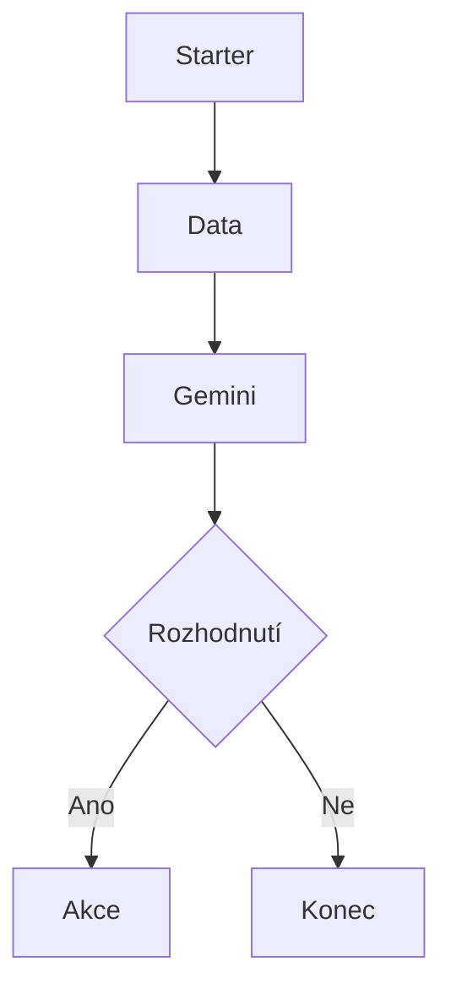

# 1. Základy Workspace Studio

<div class="lesson-meta">
<strong>Doporučený čas:</strong> 45-60 minut<br>
<strong>Výstup kapitoly:</strong> Dokážeš vysvětlit základní části flow a rozhodnout, zda se daný úkol hodí pro Workspace Studio.
</div>

## Motivace

Učitel během týdne řeší mnoho drobných informačních úkolů. Čte e-maily, třídí zprávy, kontroluje odpovědi z formulářů, hledá aktuální informace a připravuje podklady pro další hodiny.

Část těchto úkolů je opakovaná. Workspace Studio umožňuje takové situace popsat jako flow: sled kroků, který se spustí ručně, podle času nebo při určité události.

## Z čeho se skládá flow

Flow je pracovní postup složený z několika částí:

| Část | Význam | Příklad |
| --- | --- | --- |
| Starter | Určuje, kdy se flow spustí. | Nový e-mail, plánovaný čas, ruční spuštění. |
| Data step | Načte nebo připraví vstupní data. | Tělo e-mailu, řádky v tabulce, odpovědi z formuláře. |
| AI step | Nechá Gemini obsah shrnout, roztřídit nebo vyhodnotit. | Souhrn e-mailu, analýza odpovědí, výběr zpráv. |
| Decision | Rozhodne, zda má flow pokračovat. | Zpráva vyžaduje akci? |
| Action | Provede výsledek v aplikaci. | Pošle e-mail, přidá štítek, odešle zprávu do Chatu. |

Zjednodušeně:



## Kdy má automatizace smysl

Automatizace má smysl, když se úkol opakuje, má jasný vstup a je možné bezpečně určit, co se má stát s výsledkem.

Dobré scénáře:

- shrnout příchozí e-mail,
- označit e-mail vhodnými štítky,
- z odpovědí studentů vybrat opakující se problémy,
- každý pracovní den poslat krátký informační přehled,
- upozornit na zprávy, které vyžadují reakci.

Nevhodné scénáře:

- rozhodování s velkým dopadem bez kontroly člověka,
- hromadné změny dat bez možnosti snadné kontroly,
- automatické posílání citlivých informací mimo školní prostředí,
- úkoly, u kterých není jasné, podle čeho poznat správný výsledek.

## Role Gemini

Gemini ve flow nevystupuje jako samostatný učitel ani jako správce školy. Je to nástroj pro práci s obsahem.

Může pomoci například:

- shrnout delší text,
- najít úkoly a termíny,
- rozlišit, zda e-mail vyžaduje pozornost,
- seskupit podobné odpovědi,
- navrhnout další krok.

Je ale potřeba mu dát jasné instrukce. Dobrý prompt neříká jen, co má Gemini vytvořit, ale také co dělat nesmí.

## Proměnné

Proměnné předávají data mezi kroky flow. Typický příklad:

```text
Gmail Email body
→ Ask Gemini
→ Content created by Gemini
→ Gmail nebo Google Chat
```

Proměnnou si lze představit jako hodnotu, která vznikla v předchozím kroku. Pokud flow začne novým e-mailem, může další krok použít jeho předmět, odesílatele nebo tělo zprávy.

## Text a seznam

U kroku Ask Gemini je důležité rozlišit, jaký typ výstupu potřebuješ:

| Typ výstupu | Kdy se hodí |
| --- | --- |
| Text | Souhrn, doporučení, ANO/NE, jeden e-mailový výstup. |
| List | Více položek, které se mají dále zpracovávat jednotlivě. |

Pro většinu scénářů v tomto kurzu stačí **Text**. Seznam je vhodný až tehdy, když další krok potřebuje pracovat s každou položkou zvlášť, například v cyklu.

## Praktický úkol

Vyber jednu opakovanou činnost ze své práce a doplň tabulku:

| Otázka | Odpověď |
| --- | --- |
| Co se opakuje? |  |
| Jaký je vstup? |  |
| Jaký výstup potřebuji? |  |
| Kdy se má postup spustit? |  |
| Co musí před odesláním zkontrolovat člověk? |  |

## Tahák

- Flow je sled kroků.
- Starter určuje spuštění.
- Proměnné přenášejí data.
- Gemini pomáhá porozumět obsahu.
- Akční kroky mohou opravdu měnit data nebo posílat zprávy.
- Nejlepší automatizace řeší konkrétní malý problém.
