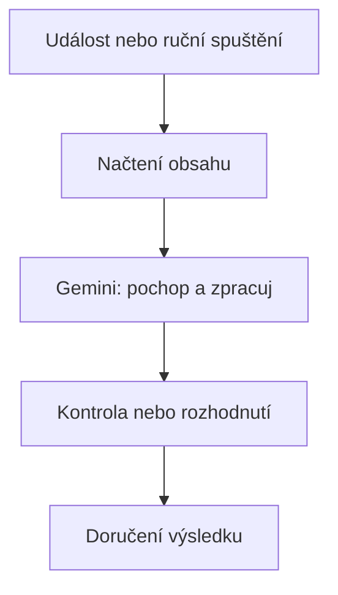

# 2. Návrh flow

<div class="lesson-meta">
<strong>Doporučený čas:</strong> 45-60 minut<br>
<strong>Výstup kapitoly:</strong> Dokážeš převést pracovní situaci na návrh flow a připravit kvalitní instrukce pro Gemini.
</div>

## Motivace

Nejčastější chyba při tvorbě automatizace je začít tlačítky. Lepší je začít pracovní situací: co se děje, proč to zabírá čas a jak poznáme dobrý výsledek.

Workspace Studio potom není hra s funkcemi, ale nástroj pro řešení konkrétního problému.

## Postup návrhu

Před stavbou flow si odpověz na pět otázek:

| Otázka | Proč je důležitá |
| --- | --- |
| Jaký problém řeším? | Bez jasného problému vznikne zbytečné flow. |
| Co je vstup? | Flow musí vědět, odkud bere data. |
| Co má Gemini rozhodnout nebo vytvořit? | AI krok potřebuje přesný úkol. |
| Co se má stát s výsledkem? | Výstup musí někam směřovat. |
| Kde je bezpečnostní hranice? | Některé výsledky má nejdřív zkontrolovat člověk. |

## Návrhový vzor

Většina školních flow z tohoto kurzu používá podobný vzor:



U jednodušších flow může rozhodnutí chybět. U citlivějších flow by naopak měla být kontrola člověkem výraznější.

## Jak psát dobrý prompt

Dobrý prompt ve Workspace Studio má čtyři části:

| Část promptu | Příklad |
| --- | --- |
| Role a situace | "Analyzuj příchozí e-mail z pohledu jeho příjemce." |
| Kritéria | "Za relevantní považuj úkol, otázku, rozhodnutí nebo termín." |
| Formát výstupu | "Vrať: shrnutí, úkoly, termíny, prioritu." |
| Omezení | "Nevymýšlej informace, které v e-mailu nejsou." |

Čím lépe popíšeš hranice, tím méně bude výstup působit jako volná úvaha.

## Co má být v promptu zakázané

U školních automatizací se často vyplatí výslovně říct:

- nevymýšlej chybějící informace,
- nehodnoť jednotlivé studenty,
- nepřidávej osobní údaje, které nejsou potřeba,
- pokud něco není uvedeno, napiš "Neuvedeno",
- výstup napiš stručně a prakticky.

Tato omezení nejsou formalita. Pomáhají udržet výstup použitelný a ověřitelný.

## Bezpečnostní hranice

Automatizace může pracovat se školními daty. Proto je potřeba předem určit, co nesmí dělat bez kontroly.

| Situace | Doporučený postup |
| --- | --- |
| Flow pouze připraví souhrn pro učitele. | Nízké riziko, vhodné pro automatické odeslání sobě. |
| Flow přidává štítky do Gmailu. | Přijatelné, změna je vratná a viditelná. |
| Flow posílá výstup dalším lidem. | Testovat opatrně, zkontrolovat příjemce. |
| Flow hodnotí studenty jednotlivě. | Vyhnout se tomu, pokud to není nezbytné a jasně odůvodněné. |
| Flow mění větší množství dat. | Nejprve použít kopii nebo testovací data. |

## Praktický úkol

Navrhni flow pro jednu vlastní situaci. Použij tuto osnovu:

```text
Název flow:

Problém:

Starter:

Vstupní data:

Krok Gemini:

Výstup:

Riziko:

Jak budu testovat:
```

## Co už umím

Po této kapitole bys měl/a umět:

- rozlišit problém, vstup a výstup flow,
- zvolit vhodný starter,
- napsat prompt s kritérii a omezeními,
- poznat, kdy je potřeba kontrola člověkem.
