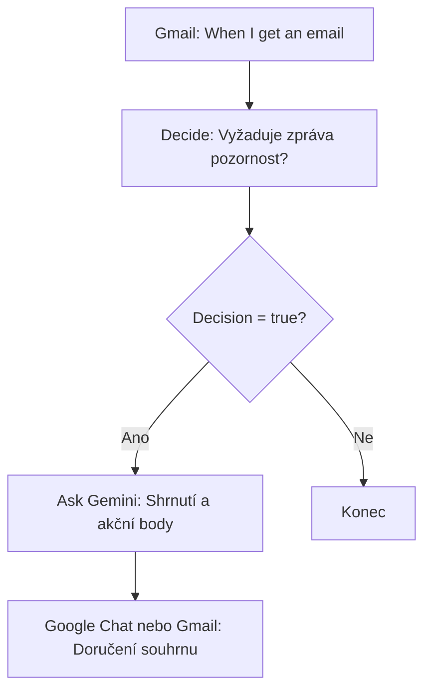
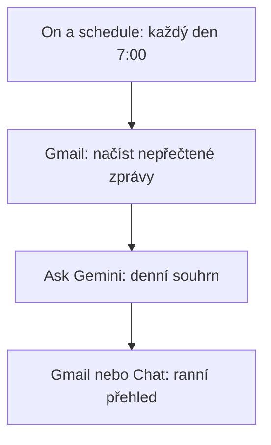

# 3. Sumarizace e-mailů

<div class="lesson-meta">
<strong>Doporučený čas:</strong> 60-90 minut<br>
<strong>Výstup kapitoly:</strong> Sestavíš flow, které rozpozná důležitý e-mail, shrne ho a doručí pracovní souhrn.
</div>

## Motivace

Školní inbox často obsahuje směs důležitých žádostí, organizačních informací, automatických oznámení a newsletterů. Učitel nepotřebuje, aby mu AI četla všechno. Potřebuje rychle poznat, co vyžaduje pozornost.

Cílem scénáře je vytvořit flow, které:

- posoudí, zda zpráva vyžaduje reakci nebo další činnost,
- stručně shrne obsah,
- vypíše úkoly, otázky, rozhodnutí a termíny,
- pošle výstup do Gmailu nebo Google Chatu.

## Varianta A: zpracování každého důležitého e-mailu

Tato varianta reaguje na nové zprávy. Je vhodná tehdy, když chceš být upozorněn/a na důležité e-maily průběžně.



### Krok 1: Starter

Vyber:

```text
Gmail → When I get an email
```

Flow se spustí při každém novém e-mailu. V dalších krocích budeš pracovat hlavně s proměnnou **Email body**.

### Krok 2: Decide

Pomocí kroku **Decide** nech Gemini rozhodnout, zda zpráva vyžaduje další pozornost.

Použij vstup:

```text
Email body
```

Instrukce:

```text
Analyzuj příchozí e-mail z pohledu jeho příjemce.

Rozhodni, zda obsahuje něco, co ode mě vyžaduje nebo rozumně očekává reakci či další činnost.

Za relevantní považuj zejména:
- úkol nebo požadavek, který mám splnit,
- otázku, na kterou mám odpovědět,
- rozhodnutí nebo schválení, které mám provést,
- téma, které mám prověřit, připravit, prodiskutovat, zkontrolovat nebo dále řešit,
- termín, závazek nebo odpovědnost, která se mě týká.

Za relevantní nepovažuj:
- newslettery, reklamy a obecná oznámení,
- čistě informativní zprávy bez očekávané reakce,
- úkoly jednoznačně určené jiné osobě,
- automatická oznámení, pokud ode mě nevyžadují konkrétní akci.

Nevymýšlej úkoly, které z obsahu zprávy jasně nevyplývají.
```

### Krok 3: Check if

Nastav podmínku:

```text
Step 2: Decision is true
```

Pokud je rozhodnutí `false`, flow skončí. Tím se zabrání posílání zbytečných souhrnů.

### Krok 4: Ask Gemini

Nech Gemini vytvořit pracovní souhrn.

```text
Analyzuj následující e-mail a připrav stručný pracovní souhrn.

Vrať:

1. SHRNUTÍ
Jednou až dvěma větami vysvětli, o čem zpráva je.

2. CO ODE MĚ ZPRÁVA VYŽADUJE
Vypiš pouze skutečné úkoly, otázky, rozhodnutí nebo následné akce.

3. TERMÍNY
Uveď všechny explicitně zmíněné termíny nebo data.
Pokud žádný termín uveden není, napiš "Neuveden".

4. PRIORITA
Urči: NÍZKÁ / STŘEDNÍ / VYSOKÁ.
Vysokou prioritu použij pouze tehdy, pokud zpráva obsahuje krátký termín, naléhavý problém nebo blokuje další činnost.

Nevymýšlej informace, které v e-mailu nejsou.

E-mail:
[Email body]
```

### Krok 5: Doručení výsledku

Výstup můžeš:

- poslat sobě do Gmailu,
- poslat jako oznámení do Google Chatu,
- použít v dalším kroku flow.

Pro první test je nejbezpečnější poslat výstup sám/sama sobě.

## Varianta B: denní souhrn nepřečtených e-mailů

Pokud nechceš dostávat upozornění průběžně, použij klidnější variantu s plánovaným spuštěním.



Tento model se hodí pro ranní začátek dne. Místo několika upozornění dostaneš jeden přehled.

## Kontrola kvality

Po testu zkontroluj:

| Kontrola | Otázka |
| --- | --- |
| Relevance | Spustilo se flow jen u zpráv, které opravdu vyžadují pozornost? |
| Úkoly | Neobjevily se ve výstupu domyšlené úkoly? |
| Termíny | Jsou uvedeny jen termíny, které byly v e-mailu opravdu napsané? |
| Priorita | Nepoužívá flow příliš často vysokou prioritu? |
| Příjemce | Posílá se souhrn jen tam, kam má? |

## Praktický úkol

Vytvoř tři testovací e-maily:

| Typ zprávy | Očekávaný výsledek |
| --- | --- |
| Newsletter bez požadavku | Flow skončí bez souhrnu. |
| E-mail s otázkou od vedení školy | Flow připraví souhrn a úkol. |
| Automatické oznámení bez akce | Flow skončí nebo dá nízkou prioritu. |

Potom porovnej skutečné chování flow s očekáváním.

## Shrnutí

Scénář ukazuje nejdůležitější princip Workspace Studio: AI nejdříve porozumí obsahu a teprve potom se rozhodne, zda má následovat akce. To je rozdíl proti obyčejnému filtru podle klíčového slova.
