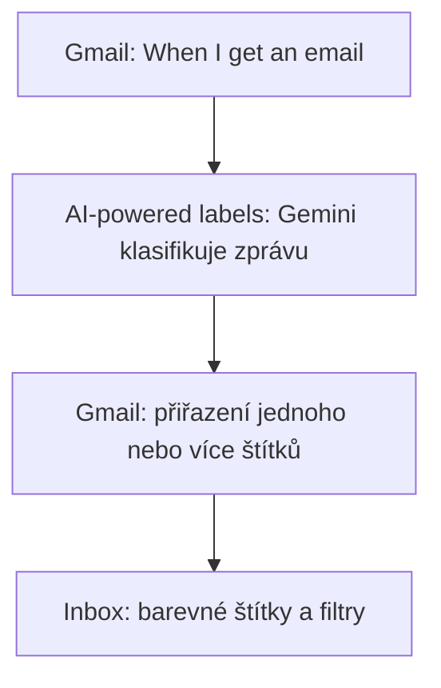

# 4. AI štítky v Gmailu

<div class="lesson-meta">
<strong>Doporučený čas:</strong> 60-90 minut<br>
<strong>Výstup kapitoly:</strong> Vytvoříš sadu AI štítků, které třídí e-maily podle významu zprávy.
</div>

## Motivace

Běžná pravidla v Gmailu třídí zprávy hlavně podle odesílatele, slov v předmětu nebo adresy příjemce. To pomůže, ale nestačí to vždy. Dvě zprávy od stejného odesílatele mohou mít úplně jiný význam: jedna je jen informace, druhá vyžaduje rychlou reakci.

AI štítky umožňují třídit zprávy podle obsahu.

## Cíl scénáře

Inbox se automaticky třídí podle významu zprávy. Jeden e-mail může dostat více štítků současně:

```text
Vedení školy + Administrativa + Vyžaduje akci + Termín
```

## Doporučené štítky

| Skupina | Štítky |
| --- | --- |
| Akce a priorita | Vyžaduje akci, Urgentní, Termín |
| Téma | Administrativa, IT, Školení, Studentské aktivity |
| Oblast nebo odesílatel | Vedení školy, Studenti |

Štítek **Odpovědět** většinou není potřeba. Štítek **Vyžaduje akci** je širší a zachytí i úkoly, u kterých není nutné odpovídat e-mailem.

## Schéma flow



## Postup

### Krok 1: Starter

Vyber:

```text
Gmail → When I get an email
```

### Krok 2: Označení e-mailu

Přidej krok pro označení e-mailu a zapni:

```text
AI-powered labels
```

U každého štítku vytvoř vlastní popis. Popis je důležitější než samotný název štítku. Podle něj Gemini rozhoduje.

## Popisy štítků

### Vyžaduje akci

```text
Použij tento štítek, pokud zpráva vyžaduje, abych něco konkrétního udělal, odpověděl, potvrdil, rozhodl, zkontroloval, odevzdal, připravil, doplnil, schválil nebo dále řešil.

Nepoužívej jej pro čistě informační zprávy, newslettery nebo oznámení bez očekávané reakce.
```

### Urgentní

```text
Použij tento štítek pouze tehdy, pokud zpráva vyžaduje rychlé řešení, obsahuje krátký termín, upozorňuje na problém bránící další činnosti nebo výslovně požaduje bezodkladnou reakci.

Neoznačuj zprávu jako urgentní pouze proto, že působí důležitě.
```

### Termín

```text
Použij tento štítek, pokud zpráva obsahuje konkrétní termín, deadline nebo datum, do kterého mám něco udělat, odevzdat, potvrdit nebo vyřešit.

Neoznačuj pouze datum konání akce, pokud z něj pro mě nevyplývá žádná povinnost.
```

### Administrativa

```text
Použij tento štítek pro provozní a administrativní záležitosti školy, například výkazy, formuláře, žádosti, cestovní vyúčtování, rozvrhy, evidenci, dokumentaci, personální nebo organizační administrativu.

Nepoužívej jej pro běžnou pedagogickou komunikaci se studenty.
```

### IT

```text
Použij tento štítek pro zprávy týkající se informačních technologií, digitálních služeb a technického provozu školy.

Patří sem zejména:
- informace od správce sítě nebo IT podpory,
- účty a přístupy,
- licence,
- nové nebo aktualizované aplikace a služby,
- hardware a software,
- bezpečnostní upozornění,
- odstávky a změny systémů,
- technické návody,
- IT školení.

Nepoužívej tento štítek pro běžnou výuku informatiky.
```

### Školení

```text
Použij tento štítek pro zprávy týkající se školení, workshopů, konferencí, webinářů, kurzů a dalšího vzdělávání učitelů nebo zaměstnanců.

Patří sem pozvánky, registrace, organizační informace, změny termínů, materiály ke školení a potvrzení účasti.

Nepoužívej jej pro studentské akce ani pro běžné provozní IT informace.
```

### Studentské aktivity

```text
Použij tento štítek pro zprávy týkající se akcí a aktivit určených studentům mimo běžnou výuku, například výstav, koncertů, přednášek, exkurzí, soutěží, workshopů, výjezdů, pobytů, kulturních nebo sportovních akcí.

Nepoužívej tento štítek pro běžnou komunikaci se studenty o výuce, domácích úkolech, klasifikaci nebo omluvenkách.
```

### Studenti

```text
Použij tento štítek pro zprávy od studentů nebo zprávy, jejichž hlavním tématem je konkrétní požadavek, otázka, omluva, úkol, práce nebo jiná komunikace jednotlivého studenta či skupiny studentů.
```

### Vedení školy

```text
Použij tento štítek pro zprávy od vedení školy nebo zprávy, které se týkají pokynů, rozhodnutí, organizace nebo požadavků vedení školy.

Typicky jde o ředitele, zástupce ředitele nebo jinou osobu jednající jménem vedení.
```

## Zobrazení štítků v Gmailu

V Gmailu otevři:

```text
Nastavení → Zobrazit všechna nastavení → Štítky
```

U důležitých štítků nastav:

```text
Zobrazit v seznamu zpráv
```

Přímo v inboxu se vyplatí zobrazovat hlavně:

- Vyžaduje akci,
- Urgentní,
- Termín.

Ostatní štítky mohou sloužit jako tematické filtry.

## Doporučené barvy

| Štítek | Barva |
| --- | --- |
| Urgentní | červená |
| Termín | oranžová |
| Vyžaduje akci | žlutá |
| Vedení školy | fialová |
| IT | modrá |
| Školení | zelená |
| Studenti / Studentské aktivity | světle modrá |
| Administrativa | šedá |

## Kontrola kvality

Po několika dnech používání projdi alespoň 20 označených zpráv a polož si otázky:

- Dostaly důležité e-maily štítek **Vyžaduje akci**?
- Nepoužívá se **Urgentní** příliš často?
- Nepletou se **Studenti** a **Studentské aktivity**?
- Jsou tematické štítky užitečné, nebo jich je moc?

Pokud se štítek používá špatně, neupravuj jen jeho název. Uprav hlavně popis.

## Praktický úkol

Připrav pět testovacích e-mailů a odhadni štítky ještě před spuštěním:

| Zpráva | Očekávané štítky |
| --- | --- |
| Žádost vedení o doplnění podkladů do pátku | Vedení školy, Administrativa, Vyžaduje akci, Termín |
| Pozvánka na webinář o AI | Školení, případně IT |
| Student prosí o vysvětlení zadání | Studenti, Vyžaduje akci |
| Newsletter vzdělávací firmy | Bez akčního štítku, případně Školení |
| Upozornění na odstávku školního systému | IT, případně Termín |

## Shrnutí

AI štítky jsou užitečné tehdy, když jejich popisy vyjadřují skutečný význam zprávy. Menší počet dobře popsaných štítků je lepší než dlouhý seznam neurčitých kategorií.
