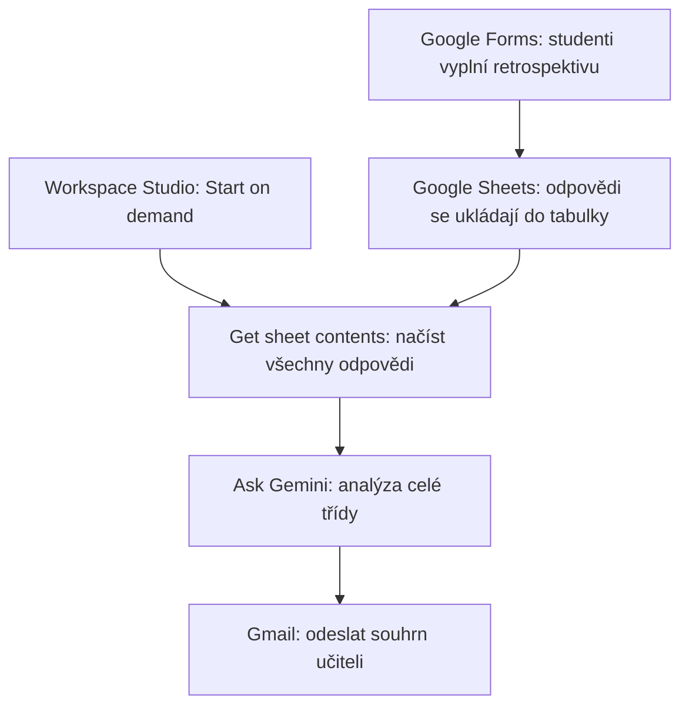

# 5. Vyhodnocení retrospektivy

<div class="lesson-meta">
<strong>Doporučený čas:</strong> 90 minut<br>
<strong>Výstup kapitoly:</strong> Sestavíš flow, které načte odpovědi z Google Forms/Sheets a připraví učiteli souhrn pro další hodinu.
</div>

## Motivace

Krátká retrospektiva po hodině může učiteli ukázat, co třída pochopila a co je potřeba zopakovat. Problém je v tom, že ruční pročítání odpovědí zabírá čas, hlavně když se opakuje každý týden.

V tomto scénáři studenti odpoví ve Forms, odpovědi se uloží do Sheets a Workspace Studio je jednorázově předá Gemini.

## Cíl scénáře

Gemini má z odpovědí celé třídy:

1. určit, co třída zvládá,
2. najít slabiny,
3. doporučit, co zopakovat,
4. navrhnout prvních 10-15 minut následující hodiny.

## Použité aplikace

- Google Forms,
- Google Sheets,
- Workspace Studio,
- Gemini,
- Gmail.

## Otázky retrospektivy

Formulář drž krátký. Pět dobrých otázek dá často lepší výsledek než dlouhý dotazník.

### Stupnice 1-5

1. Jak jistě zvládneš používat styly nadpisů a vytvořit z nich automatický obsah?
2. Jak jistě zvládneš samostatně upravit delší odborný dokument tak, aby měl konzistentní nadpisy, odstavce, zalomení stránek a popisky?
3. Jak jistě zvládneš pomocí Zotero vložit citaci, změnit citační styl a aktualizovat seznam literatury?

### Otevřené otázky

4. Představ si, že máš zítra odevzdat maturitní práci. Co bys před odevzdáním v dokumentu zkontroloval/a nebo aktualizoval/a?
5. Co z práce ve Wordu nebo Zotero ještě potřebuješ vysvětlit nebo procvičit?

## Proč nepoužít trigger "When a new response comes in"

Pokud je cílem souhrn celé třídy, flow nesmí běžet při každé jednotlivé odpovědi.

```text
15 odpovědí
→ 15 spuštění flow
→ 15 souhrnů
→ 15 e-mailů
```

Proto použijeme **Start on demand**. Učitel flow spustí až ve chvíli, kdy chce vyhodnotit celou třídu.

## Schéma flow



## Postup

### Krok 1: Start on demand

Vyber:

```text
Start manually / Start on demand
```

Volitelně přidej vstupní parametry:

```text
Třída
Téma
```

Například:

```text
Třída = 4.AJ
Téma = Typografie v MS Word a Zotero
```

Tyto hodnoty můžeš později použít v promptu.

### Krok 2: Get sheet contents

Vyber tabulku s odpověďmi z Forms.

Pro načtení všech řádků nastav:

```text
Column: Timestamp
Value: Any
```

`Timestamp` je automatická časová značka odeslání odpovědi z Google Forms. Do dalšího kroku předávej hlavně sloupce s odpověďmi, ne samotný timestamp.

### Krok 3: Ask Gemini

Do promptu vlož proměnné s odpověďmi na všech pět otázek.

```text
Analyzuj odpovědi studentů z retrospektivy k tématu Typografie v MS Word a Zotero.

Pracuj s celou třídou jako skupinou. Nehodnoť jednotlivé studenty a nevypisuj jejich odpovědi po jednom.

Níže jsou odpovědi studentů:

STYLY A AUTOMATICKÝ OBSAH:
[proměnná otázky 1]

TYPOGRAFIE ODBORNÉHO DOKUMENTU:
[proměnná otázky 2]

ZOTERO:
[proměnná otázky 3]

KONTROLA MATURITNÍ PRÁCE:
[proměnná otázky 4]

CO STUDENTI POTŘEBUJÍ PROCVIČIT:
[proměnná otázky 5]

Na základě těchto odpovědí vyhodnoť třídu jako celek.

1. CO TŘÍDA ZVLÁDÁ
Urči, které dovednosti studenti podle odpovědí většinou zvládají dobře.
U stupnic zohledni celkový trend a u otevřených odpovědí hledej opakující se známky praktického porozumění.

2. KDE JSOU SLABINY
Urči nejvýraznější oblasti nejistoty, chybějícího porozumění nebo slabší praktické aplikace.
Hledej opakující se problémy napříč odpověďmi.
Nevytvářej problém tam, kde pro něj nejsou v datech důkazy.

3. CO ZOPAKOVAT
Navrhni maximálně 3 konkrétní témata nebo dovednosti, které má smysl v příští hodině zopakovat.
Seřaď je podle priority.

4. PRVNÍCH 10-15 MINUT PŘÍŠTÍ HODINY
Navrhni krátkou praktickou aktivitu nebo sled aktivit, které přímo reagují na zjištěné slabiny.
Preferuj praktickou práci před dalším výkladem.

Výstup napiš stručně v tomto formátu:

CO TŘÍDA ZVLÁDÁ
- ...

SLABINY
- ...

CO ZOPAKOVAT
1. ...
2. ...
3. ...

PRVNÍCH 10-15 MINUT PŘÍŠTÍ HODINY
- 0-5 min: ...
- 5-10 min: ...
- 10-15 min: ...

DOPORUČENÉ ZAMĚŘENÍ PŘÍŠTÍ HODINY:
...

Důležité:
- vycházej pouze z dodaných odpovědí,
- nevymýšlej informace, které v datech nejsou,
- nerozebírej jednotlivé studenty,
- buď konkrétní a praktický.
```

### Krok 4: Gmail

Přidej:

```text
Send an email
```

Předmět:

```text
Vyhodnocení retrospektivy - Typografie a Zotero
```

Do těla vlož výstup z Ask Gemini.

## Kontrola kvality

U tohoto scénáře je důležité, aby Gemini nehodnotilo jednotlivé studenty. Cílem je podpora plánování výuky, ne individuální klasifikace.

| Kontrola | Správné chování |
| --- | --- |
| Práce se skupinou | Výstup popisuje třídu jako celek. |
| Otevřené odpovědi | Gemini hledá opakující se témata, ne izolované výroky. |
| Doporučení | Návrhy navazují na skutečné slabiny v datech. |
| Časový plán | Prvních 10-15 minut je praktických a realistických. |

## Praktický úkol

Vytvoř malou zkušební tabulku s 8-10 odpověďmi. Záměrně do ní vlož:

- několik jistých odpovědí,
- několik nejistých odpovědí,
- opakující se problém,
- jednu odpověď, která je mimo téma.

Potom ověř, zda souhrn zvýrazní opakující se problém a nenechá se rozhodit jednou zvláštní odpovědí.

## Shrnutí

Tento scénář ukazuje silnou stránku Workspace Studio: spojení tabulkových dat a AI analýzy. Učitel nezíská známku za jednotlivého studenta, ale rychlý obraz celé skupiny a návrh dalšího kroku.
