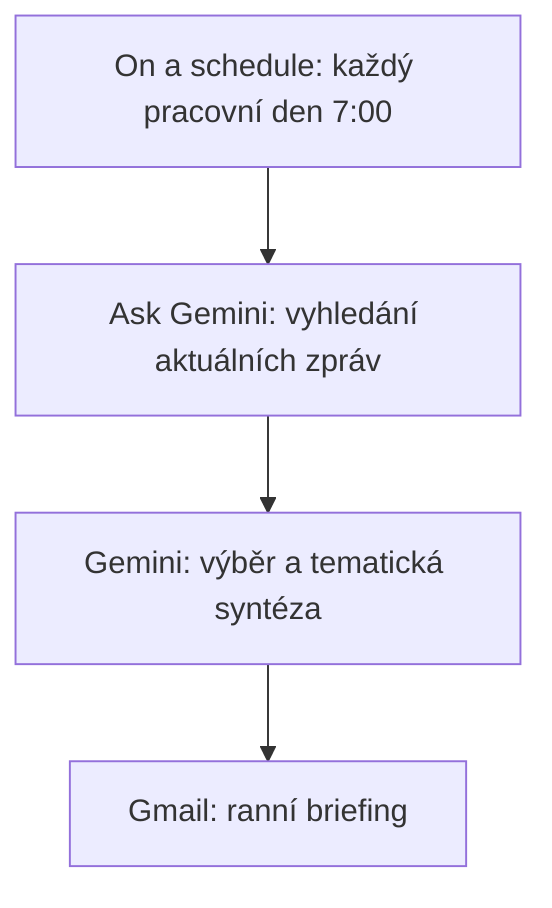

# 6. Ranní briefing

<div class="lesson-meta">
<strong>Doporučený čas:</strong> 60-90 minut<br>
<strong>Výstup kapitoly:</strong> Vytvoříš plánované flow, které připraví stručný e-mailový přehled aktuálních zpráv o českém školství.
</div>

## Motivace

Učitelé často potřebují sledovat změny ve školství, ale nemají čas každé ráno procházet několik webů. Ranní briefing ukazuje, jak může Workspace Studio jednou denně připravit krátký přehled relevantních zpráv.

Tento scénář je náročnější než předchozí, protože pracuje s aktuálními informacemi z webu. O to důležitější je požadovat zdroje a odkazy.

## Cíl scénáře

Jednou denně získat krátký přehled zajímavých a relevantních zpráv o českém školství. Gemini vyhledá aktuální informace, vybere důležité zprávy a připraví tematicky členěný e-mail.

## Schéma flow



## Postup

### Krok 1: On a schedule

Nastav například:

```text
Každý pracovní den
7:00
```

Čas zvol podle toho, kdy má přehled dorazit. Pro školní provoz dává smysl začátek pracovního dne.

### Krok 2: Ask Gemini

Gemini musí mít povoleno vyhledávání aktuálních informací na webu.

```text
Vyhledej nejzajímavější a nejdůležitější zprávy z posledních 24-48 hodin, které se týkají školství a vzdělávání v České republice.

Chci pestrý výběr zdrojů a témat. Neomezuj se primárně na MŠMT.

Preferuj kombinaci těchto typů zdrojů:
- oficiální instituce: MŠMT, ČŠI, CERMAT, NPI,
- vzdělávací média a analytické organizace: EDUin, Řízení školy, EDUzín apod.,
- celostátní média: ČT24, iROZHLAS, Seznam Zprávy, Hospodářské noviny, Deník N apod.,
- univerzity, výzkumné organizace a odborné instituce,
- relevantní profesní organizace a asociace.

Dodrž tato pravidla:
- maximálně 1 zpráva z jednoho zdroje,
- maximálně 1 čistě ministerská nebo legislativní zpráva,
- alespoň 1 zpráva s praktickým dopadem na učitele nebo školy,
- alespoň 1 zpráva o výuce, technologiích, AI, digitalizaci nebo inovacích,
- pokud je dostupná, zařaď alespoň 1 zprávu založenou na datech, výzkumu nebo průzkumu,
- nevkládej více zpráv o stejné události.

Vyber maximálně 5 zpráv.

Výstup připrav jako stručný ranní e-mail pro učitele.

Použij tematické sekce podle obsahu, například:

POLITIKA A ZMĚNY VE ŠKOLSTVÍ

UČITELÉ A KAŽDODENNÍ CHOD ŠKOLY

VÝUKA A STUDENTI

TECHNOLOGIE, AI A DIGITALIZACE

VÝZKUMY, DATA A TRENDY

Pokud pro některou sekci není žádná významná zpráva, sekci vůbec nevypisuj.

U každé zprávy uveď:
- krátký nadpis,
- shrnutí ve 2-3 větách,
- proč je zpráva relevantní pro učitele nebo školu,
- zdroj a odkaz.

Pokud více zdrojů píše o stejné události, spoj ji do jedné položky.

Na závěr přidej:

CO BYCH DNES NEPŘEHLÉDL
Vyber jednu zprávu, která má největší praktický nebo dlouhodobý dopad, a jednou až dvěma větami vysvětli proč.

CO SLEDOVAT DÁL
Uveď maximálně 2 témata, u kterých lze očekávat další vývoj.

Piš česky, stručně a věcně.
Celý přehled musí být čitelný přibližně za 2-3 minuty.
```

### Krok 3: Gmail

Přidej:

```text
Send an email
```

Předmět:

```text
Ranní briefing - České školství
```

Do těla vlož pouze výstup z Ask Gemini.

## Proč jsou důležité zdroje

U aktuálních zpráv nestačí pěkný souhrn. Výstup musí obsahovat odkazy, aby si učitel mohl ověřit původ informace.

Bez zdrojů je briefing jen text, kterému se špatně důvěřuje. Se zdroji je to pracovní rozcestník.

## Možné úpravy scénáře

| Varianta | Kdy se hodí |
| --- | --- |
| Týdenní briefing | Pokud denní přehled vytváří příliš mnoho e-mailů. |
| Jen AI a technologie | Pro učitele informatiky nebo koordinátora ICT. |
| Jen legislativa a MŠMT | Pro vedení školy. |
| Regionální zprávy | Pro školy, které sledují místní zřizovatele a kraj. |

## Kontrola kvality

Po prvních několika bězích zkontroluj:

- zda odkazy opravdu vedou na použité zdroje,
- zda se neopakuje stále stejný typ zpráv,
- zda výstup není příliš dlouhý,
- zda se do přehledu nedostávají staré nebo okrajové zprávy,
- zda předmět e-mailu umožňuje briefing snadno najít.

## Praktický úkol

Uprav prompt pro jinou oblast:

- digitální bezpečnost ve školách,
- AI ve vzdělávání,
- přijímací zkoušky a maturita,
- evropské vzdělávací trendy,
- ekonomika a trh práce.

Zachovej ale pravidlo zdrojů a odkazů.

## Shrnutí

Ranní briefing ukazuje plánovanou automatizaci s aktuálními informacemi. Je užitečný tehdy, když je stručný, zdrojovaný a pravidelný. Jakmile začne zahlcovat, je lepší snížit četnost nebo zúžit téma.
