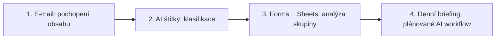

# 8. Workshop pro učitele

<strong>Doporučený čas:</strong> 3-4 hodiny nebo 6-8 vyučovacích hodin 
<strong>Výstup kapitoly:</strong> Dokážeš vést praktické školení Workspace Studio od ukázky hotového výsledku po vlastní návrh účastníků.

## Motivace

Workspace Studio se nejlépe učí na hotovém výsledku. Účastníci nejdřív uvidí, co flow dělá, a až potom rozeberou jednotlivé kroky. Díky tomu nevnímají automatizaci jako sadu technických nastavení, ale jako odpověď na pracovní situaci.

## Doporučená struktura

Začni jednoduchým osobním workflow a postupně přejdi k automatizacím, které pracují s více aplikacemi a agregovanými daty.

## Harmonogram

| Čas | Aktivita | Výstup |
| --- | --- | --- |
| 0-15 min | Úvod a ukázka hotového flow | Účastníci vidí, co má být výsledkem. |
| 15-45 min | Základy flow a proměnných | Účastníci rozumí starteru, krokům a výstupům. |
| 45-90 min | Scénář 1: sumarizace e-mailů | Hotové nebo rozpracované flow pro souhrn zpráv. |
| 90-120 min | Scénář 2: AI štítky | Sada navržených štítků a jejich popisů. |
| 120-165 min | Scénář 3: retrospektiva | Flow pro analýzu odpovědí z Forms/Sheets. |
| 165-210 min | Scénář 4: ranní briefing | Návrh plánovaného informačního flow. |
| 210-240 min | Vlastní návrh a sdílení | Každý účastník popíše vlastní použitelné flow. |

U kratšího školení vyber první dva scénáře a zbylé použij jako ukázku.

## Didaktický postup u každého scénáře

1. Ukaž hotový výsledek.
2. Zeptej se, jaký pracovní problém řeší.
3. Nakresli jednoduché schéma flow.
4. Projdi kroky v rozhraní.
5. Vysvětli prompt a jeho omezení.
6. Spusť bezpečný test.
7. Nech účastníky upravit scénář pro jejich vlastní situaci.

## Co jednotlivé scénáře ukazují

| Scénář | Hlavní princip |
| --- | --- |
| Sumarizace e-mailů | AI porozumění obsahu a rozhodování. |
| AI štítky | Klasifikace e-mailů podle významu. |
| Vyhodnocení retrospektivy | Práce s daty z Forms/Sheets a agregovaná AI analýza. |
| Ranní briefing | Plánované spuštění, web research a automatické doručení. |

## Materiály pro účastníky

Před workshopem připrav:

- testovací e-mailové zprávy,
- ukázkový Google Formulář,
- navázaný Google Sheet s několika odpověďmi,
- bezpečnou adresu pro doručování testovacích e-mailů,
- seznam témat pro vlastní návrh flow.

## Témata pro vlastní návrh

Účastníci si mohou vybrat například:

- souhrn e-mailů od vedení školy,
- třídění omluvenek a studentských dotazů,
- vyhodnocení zpětné vazby po projektové práci,
- pravidelný přehled zpráv k vlastnímu předmětu,
- příprava návrhu odpovědi na organizační e-mail,
- kontrola, zda zadání obsahuje všechny důležité informace.

## Závěrečný checklist

Na konci workshopu by každý účastník měl umět odpovědět:

| Otázka | Ano |
| --- | --- |
| Vím, jaký problém moje flow řeší. |  |
| Vím, kdy se flow spouští. |  |
| Vím, jaké proměnné používám. |  |
| Můj prompt obsahuje omezení proti domýšlení. |  |
| Testoval/a jsem na bezpečných datech. |  |
| Umím najít běh v Activity. |  |
| Vím, jak flow vypnout nebo upravit. |  |

## Shrnutí

Dobré školení Workspace Studio nestojí na množství ukázaných funkcí. Stojí na tom, že účastníci pochopí návrhový vzor: pracovní situace, vstup, AI zpracování, kontrola, akce. Jakmile tento vzor drží v hlavě, mohou si další flow navrhovat sami.
