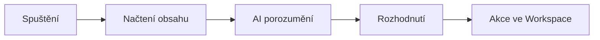

# Workspace Studio

<strong>Doporučený čas:</strong> 6-8 vyučovacích hodin 
<strong>Výstup kurzu:</strong> Účastník dokáže navrhnout, sestavit, otestovat a upravit jednoduché flow v Google Workspace Studio.

Workspace Studio umožňuje stavět automatizace nad aplikacemi Google Workspace. Typické flow se spustí událostí, načte data, nechá Gemini něco vyhodnotit a provede akci v Gmailu, Chatu, Sheets nebo jiné službě.

Tento kurz je napsaný pro učitele a školní prostředí. Všechny scénáře vycházejí z běžných situací: e-mailová zahlcenost, organizace inboxu, reflexe výuky a sledování zpráv ze školství.

## Co se naučíš

Po absolvování kurzu bys měl/a umět:

- popsat, z čeho se skládá flow,
- zvolit vhodný spouštěč,
- rozlišit kroky pro načtení dat, rozhodování, AI zpracování a akci,
- napsat prompt, který omezuje domýšlení a vede k použitelnému výstupu,
- bezpečně otestovat flow,
- číst historii běhů v části Activity,
- rozhodnout, které úlohy se pro Workspace Studio hodí.

## Stavba kurzu

| Kapitola | Hlavní otázka |
| --- | --- |
| [Základy Workspace Studio](01-zaklady.md) | Co je flow a kdy má automatizace smysl? |
| [Návrh flow](02-navrh-flow.md) | Jak převést pracovní situaci na kroky automatizace? |
| [Sumarizace e-mailů](03-sumarizace-emailu.md) | Jak poznat důležité zprávy a poslat si stručný souhrn? |
| [AI štítky v Gmailu](04-ai-stitky.md) | Jak automaticky třídit e-maily podle významu? |
| [Vyhodnocení retrospektivy](05-retrospektiva.md) | Jak z odpovědí studentů získat doporučení pro další hodinu? |
| [Ranní briefing](06-ranni-briefing.md) | Jak si nechat pravidelně připravit aktuální přehled zpráv? |
| [Testování a provoz](07-testovani-a-provoz.md) | Jak ověřit, že flow funguje a nezpůsobí škodu? |

## Hlavní princip

Workspace Studio je nejsilnější tam, kde automatizace potřebuje porozumět obsahu. Nejde jen o přesun dat z místa na místo. Typické dobré použití vypadá takto:

Workspace Studio je později implementovaný produkt a zatím nemá parametry plnohodnotných automatizačních platforem jako Make, n8n nebo Power Automate. Pokud úkol stojí hlavně na přesném převodu datumu, složitém formátování čísel, hromadné transformaci dat nebo napojení na mnoho externích služeb, může být vhodnější specializovaná automatizační platforma. Pokud je jádrem úkolu pochopit obsah ve Workspace, vybrat podstatné informace nebo připravit pracovní doporučení, Workspace Studio dává smysl.

## Výstup kurzu

Na konci kurzu by každý účastník měl mít alespoň jedno vlastní funkční flow:

- bezpečně otestované na zkušebních datech,
- pojmenované podle svého účelu,
- doplněné krátkou poznámkou, kdy a proč se má spouštět,
- zkontrolované v historii Activity.

## Shrnutí

Kurz nevede k tomu, aby se automatizovalo všechno. Cílem je poznat situace, kde automatizace opravdu pomůže, a postavit je tak, aby učitel neztratil přehled nad tím, co se děje.
