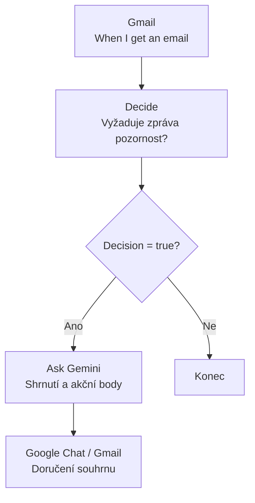
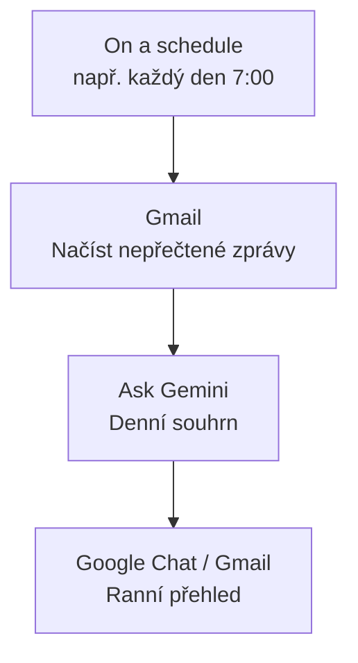
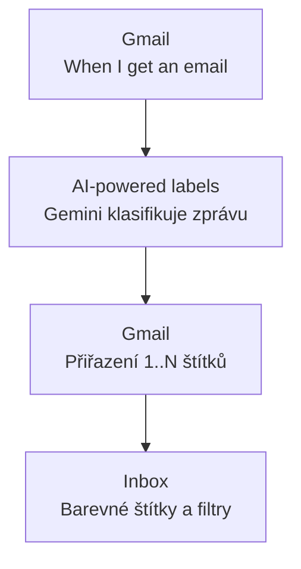
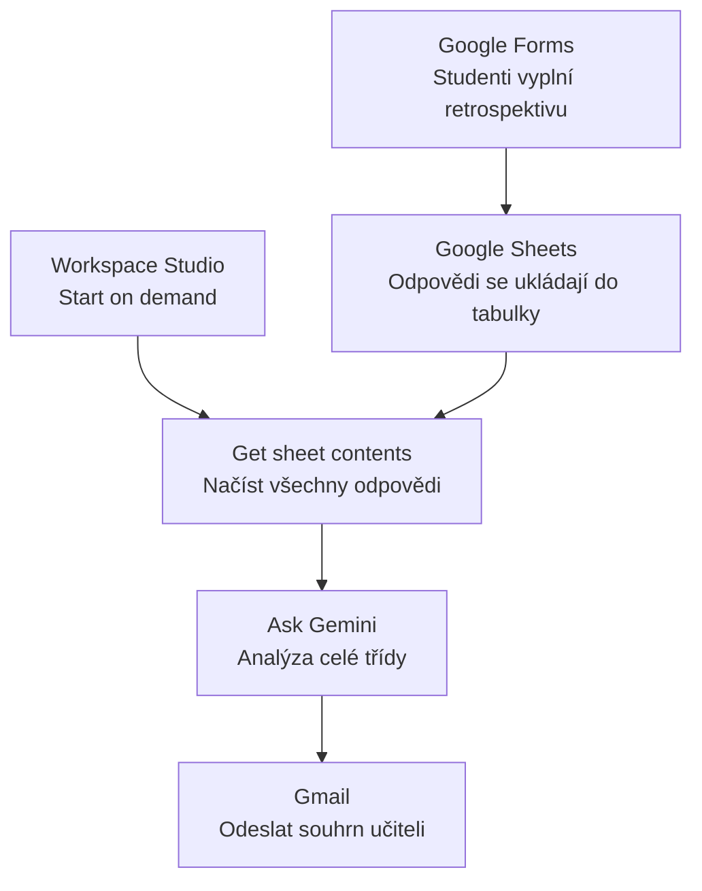
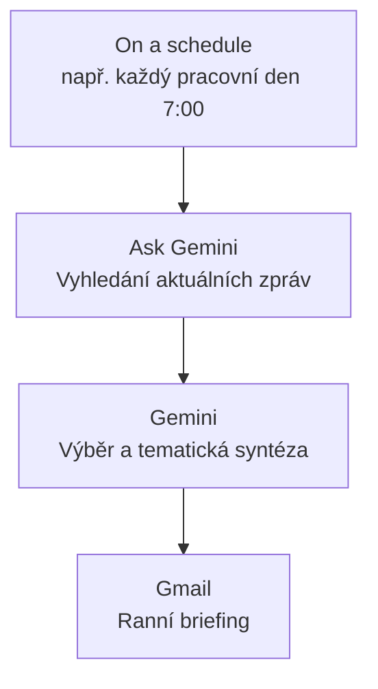
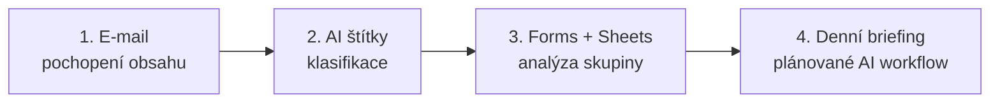

# Původní zdrojové scénáře

<div class="lesson-meta">
<strong>Účel stránky:</strong> Referenční záznam původních scénářů, ze kterých vznikl kurz Workspace Studio.<br>
<strong>Doporučení:</strong> Pro výuku používejte především rozpracované kapitoly kurzu. Tato stránka slouží jako zdroj promptů a rychlá pracovní reference.
</div>

## Google Workspace Studio – 4 praktické scénáře pro učitele

Tato kapitola obsahuje čtyři hotové scénáře pro Google Workspace Studio. Jsou zvolené tak, aby ukázaly různé typy automatizace:

1. **Sumarizace e-mailů** – AI vytáhne z e-mailů to podstatné.
2. **Štítky v e-mailech s pomocí AI** – automatická organizace inboxu podle významu zprávy.
3. **Vyhodnocení retrospektivy** – analýza odpovědí studentů z Forms/Sheets.
4. **Ranní briefing: České školství** – pravidelný přehled aktuálních zpráv zaslaný e-mailem.

> **Doporučení pro školení:** u každého scénáře nejdříve ukažte hotový výsledek a teprve potom flow rozeberte po jednotlivých krocích.

---

## 1. Sumarizace e-mailů

## Cíl

Učitel dostává velké množství e-mailů. Cílem flow je využít Gemini k tomu, aby:

- rozpoznalo, zda zpráva vyžaduje pozornost,
- stručně shrnulo obsah,
- vytáhlo úkoly, otázky, rozhodnutí nebo termíny,
- připravilo výstup vhodný pro rychlé přečtení.

## Varianta A – zpracování každého důležitého e-mailu

### Schéma



## Postup

### Krok 1 – Starter

Vyberte:

**Gmail → When I get an email**

Flow se spustí při každém novém e-mailu.

### Krok 2 – Decide

Pomocí kroku **Decide** nechte Gemini rozhodnout, zda zpráva vyžaduje další pozornost.

#### Prompt / instrukce pro Decide

```text
Analyzuj příchozí e-mail z pohledu jeho příjemce.

Rozhodni, zda obsahuje něco, co ode mě vyžaduje nebo rozumně očekává reakci či další činnost.

Za relevantní považuj zejména:
- úkol nebo požadavek, který mám splnit,
- otázku, na kterou mám odpovědět,
- rozhodnutí nebo schválení, které mám provést,
- téma, které mám prověřit, připravit, prodiskutovat, zkontrolovat nebo dále řešit,
- termín, závazek nebo odpovědnost, která se mě týká.

Za relevantní nepovažuj:
- newslettery, reklamy a obecná oznámení,
- čistě informativní zprávy bez očekávané reakce,
- úkoly jednoznačně určené jiné osobě,
- automatická oznámení, pokud ode mě nevyžadují konkrétní akci.

Nevymýšlej úkoly, které z obsahu zprávy jasně nevyplývají.
```

Jako vstup použijte proměnnou:

**Email body**

### Krok 3 – Check if

Nastavte podmínku:

```text
Step 2: Decision is true
```

Pokud je rozhodnutí `false`, flow skončí.

### Krok 4 – Ask Gemini

Nechte Gemini vytvořit rychlý souhrn.

#### Prompt

```text
Analyzuj následující e-mail a připrav stručný pracovní souhrn.

Vrať:

1. SHRNUTÍ
Jednou až dvěma větami vysvětli, o čem zpráva je.

2. CO ODE MĚ ZPRÁVA VYŽADUJE
Vypiš pouze skutečné úkoly, otázky, rozhodnutí nebo následné akce.

3. TERMÍNY
Uveď všechny explicitně zmíněné termíny nebo data.
Pokud žádný termín uveden není, napiš „Neuveden“.

4. PRIORITA
Urči: NÍZKÁ / STŘEDNÍ / VYSOKÁ.
Vysokou prioritu použij pouze tehdy, pokud zpráva obsahuje krátký termín, naléhavý problém nebo blokuje další činnost.

Nevymýšlej informace, které v e-mailu nejsou.

E-mail:
[Email body]
```

### Krok 5 – Doručení výsledku

Výstup můžete:

- poslat sobě do Gmailu,
- poslat jako oznámení do Google Chatu,
- případně použít v dalším kroku flow.

---

## Varianta B – denní souhrn nepřečtených e-mailů

Pro klidnější inbox lze použít periodické zpracování.



---

## 2. Štítky v e-mailech s pomocí AI

## Cíl

Inbox se automaticky třídí podle významu zprávy, ne jen podle odesílatele nebo klíčových slov.

AI může jednomu e-mailu přiřadit více štítků současně, například:

**Vedení školy + Administrativa + Vyžaduje akci + Termín**

## Doporučené štítky

### Akce a priorita

- **Vyžaduje akci**
- **Urgentní**
- **Termín**

### Téma

- **Administrativa**
- **IT**
- **Školení**
- **Studentské aktivity**

### Oblast / odesílatel

- **Vedení školy**
- **Studenti**

> Štítek **Odpovědět** je většinou možné vynechat. `Vyžaduje akci` je širší a zachytí i úkoly, u kterých není nutné odpovídat e-mailem.

## Schéma



## Postup

### Krok 1 – Starter

Vyberte:

**Gmail → When I get an email**

### Krok 2 – práce se štítky

Přidejte krok pro označení e-mailu a zapněte:

**AI-powered labels**

U každého štítku vytvořte vlastní popis.

---

## Prompty / popisy pro jednotlivé AI štítky

### Vyžaduje akci

```text
Použij tento štítek, pokud zpráva vyžaduje, abych něco konkrétního udělal, odpověděl, potvrdil, rozhodl, zkontroloval, odevzdal, připravil, doplnil, schválil nebo dále řešil.

Nepoužívej jej pro čistě informační zprávy, newslettery nebo oznámení bez očekávané reakce.
```

### Urgentní

```text
Použij tento štítek pouze tehdy, pokud zpráva vyžaduje rychlé řešení, obsahuje krátký termín, upozorňuje na problém bránící další činnosti nebo výslovně požaduje bezodkladnou reakci.

Neoznačuj zprávu jako urgentní pouze proto, že působí důležitě.
```

### Termín

```text
Použij tento štítek, pokud zpráva obsahuje konkrétní termín, deadline nebo datum, do kterého mám něco udělat, odevzdat, potvrdit nebo vyřešit.

Neoznačuj pouze datum konání akce, pokud z něj pro mě nevyplývá žádná povinnost.
```

### Administrativa

```text
Použij tento štítek pro provozní a administrativní záležitosti školy, například výkazy, formuláře, žádosti, cestovní vyúčtování, rozvrhy, evidenci, dokumentaci, personální nebo organizační administrativu.

Nepoužívej jej pro běžnou pedagogickou komunikaci se studenty.
```

### IT

```text
Použij tento štítek pro zprávy týkající se informačních technologií, digitálních služeb a technického provozu školy.

Patří sem zejména:
- informace od správce sítě nebo IT podpory,
- účty a přístupy,
- licence,
- nové nebo aktualizované aplikace a služby,
- hardware a software,
- bezpečnostní upozornění,
- odstávky a změny systémů,
- technické návody,
- IT školení.

Nepoužívej tento štítek pro běžnou výuku informatiky.
```

### Školení

```text
Použij tento štítek pro zprávy týkající se školení, workshopů, konferencí, webinářů, kurzů a dalšího vzdělávání učitelů nebo zaměstnanců.

Patří sem pozvánky, registrace, organizační informace, změny termínů, materiály ke školení a potvrzení účasti.

Nepoužívej jej pro studentské akce ani pro běžné provozní IT informace.
```

### Studentské aktivity

```text
Použij tento štítek pro zprávy týkající se akcí a aktivit určených studentům mimo běžnou výuku, například výstav, koncertů, přednášek, exkurzí, soutěží, workshopů, výjezdů, pobytů, kulturních nebo sportovních akcí.

Nepoužívej tento štítek pro běžnou komunikaci se studenty o výuce, domácích úkolech, klasifikaci nebo omluvenkách.
```

### Studenti

```text
Použij tento štítek pro zprávy od studentů nebo zprávy, jejichž hlavním tématem je konkrétní požadavek, otázka, omluva, úkol, práce nebo jiná komunikace jednotlivého studenta či skupiny studentů.
```

### Vedení školy

```text
Použij tento štítek pro zprávy od vedení školy nebo zprávy, které se týkají pokynů, rozhodnutí, organizace nebo požadavků vedení školy.

Typicky jde o ředitele, zástupce ředitele nebo jinou osobu jednající jménem vedení.
```

---

## Zobrazení štítků v Gmailu

V Gmailu:

**Nastavení → Zobrazit všechna nastavení → Štítky**

U důležitých štítků nastavte:

**Zobrazit v seznamu zpráv**

Pro přehlednost doporučujeme zobrazovat přímo v inboxu hlavně:

- Vyžaduje akci
- Urgentní
- Termín

Ostatní mohou zůstat jako tematické filtry.

### Barvy

V levém panelu Gmailu:

**štítek → ⋮ → Barva štítku**

Doporučení:

- Urgentní → červená
- Termín → oranžová
- Vyžaduje akci → žlutá
- Vedení školy → fialová
- IT → modrá
- Školení → zelená
- Studenti / Studentské aktivity → světle modrá
- Administrativa → šedá

---

## 3. Vyhodnocení retrospektivy

## Cíl

Studenti po hodině vyplní krátkou reflexi v Google Forms.

Odpovědi se automaticky ukládají do Google Sheets a Workspace Studio je následně jednorázově předá Gemini, které:

1. určí, co třída zvládá,
2. najde slabiny,
3. doporučí, co zopakovat,
4. navrhne prvních 10–15 minut následující hodiny.

## Použité aplikace

- Google Forms
- Google Sheets
- Workspace Studio
- Gemini
- Gmail

## Otázky retrospektivy

Formulář obsahuje pouze 5 otázek.

### Stupnice 1–5

1. **Jak jistě zvládneš používat styly nadpisů a vytvořit z nich automatický obsah?**
2. **Jak jistě zvládneš samostatně upravit delší odborný dokument tak, aby měl konzistentní nadpisy, odstavce, zalomení stránek a popisky?**
3. **Jak jistě zvládneš pomocí Zotero vložit citaci, změnit citační styl a aktualizovat seznam literatury?**

### Otevřené otázky

4. **Představ si, že máš zítra odevzdat maturitní práci. Co bys před odevzdáním v dokumentu zkontroloval/a nebo aktualizoval/a?**

5. **Co z práce ve Wordu nebo Zotero ještě potřebuješ vysvětlit nebo procvičit?**

## Proč nepoužít trigger „When a new response comes in“

Pokud je cílem souhrn celé třídy, flow nesmí běžet při každé jednotlivé odpovědi.

Jinak by 15 respondentů znamenalo:

```text
15 odpovědí
→ 15 spuštění flow
→ 15 souhrnů
→ 15 e-mailů
```

Proto použijeme **Start on demand**.

## Schéma



## Postup

### Krok 1 – Start on demand

Vyberte:

**Start manually / Start on demand**

Volitelně lze přidat vstupní parametry:

```text
Třída
Téma
```

Například:

```text
Třída = 4.AJ
Téma = Typografie v MS Word a Zotero
```

Tyto hodnoty lze později použít jako proměnné v promptu.

### Krok 2 – Get sheet contents

Vyberte tabulku s odpověďmi z Forms.

Pro načtení všech řádků nastavte:

```text
Column: Timestamp
Value: Any
```

`Timestamp` je automatická časová značka odeslání odpovědi z Google Forms.

Do dalšího kroku nepředáváme samotný Timestamp, ale pět sloupců s odpověďmi.

### Krok 3 – Ask Gemini

Do promptu vložte jako proměnné všech pět sloupců:

- odpovědi na otázku 1,
- odpovědi na otázku 2,
- odpovědi na otázku 3,
- odpovědi na otázku 4,
- odpovědi na otázku 5.

#### Prompt

```text
Analyzuj odpovědi studentů z retrospektivy k tématu Typografie v MS Word a Zotero.

Pracuj s celou třídou jako skupinou. Nehodnoť jednotlivé studenty a nevypisuj jejich odpovědi po jednom.

Níže jsou odpovědi studentů:

STYLY A AUTOMATICKÝ OBSAH:
[proměnná otázky 1]

TYPOGRAFIE ODBORNÉHO DOKUMENTU:
[proměnná otázky 2]

ZOTERO:
[proměnná otázky 3]

KONTROLA MATURITNÍ PRÁCE:
[proměnná otázky 4]

CO STUDENTI POTŘEBUJÍ PROCVIČIT:
[proměnná otázky 5]

Na základě těchto odpovědí vyhodnoť třídu jako celek.

1. CO TŘÍDA ZVLÁDÁ
Urči, které dovednosti studenti podle odpovědí většinou zvládají dobře.
U stupnic zohledni celkový trend a u otevřených odpovědí hledej opakující se známky praktického porozumění.

2. KDE JSOU SLABINY
Urči nejvýraznější oblasti nejistoty, chybějícího porozumění nebo slabší praktické aplikace.
Hledej opakující se problémy napříč odpověďmi.
Nevytvářej problém tam, kde pro něj nejsou v datech důkazy.

3. CO ZOPAKOVAT
Navrhni maximálně 3 konkrétní témata nebo dovednosti, které má smysl v příští hodině zopakovat.
Seřaď je podle priority.

4. PRVNÍCH 10–15 MINUT PŘÍŠTÍ HODINY
Navrhni krátkou praktickou aktivitu nebo sled aktivit, které přímo reagují na zjištěné slabiny.
Preferuj praktickou práci před dalším výkladem.

Výstup napiš stručně v tomto formátu:

CO TŘÍDA ZVLÁDÁ
- ...

SLABINY
- ...

CO ZOPAKOVAT
1. ...
2. ...
3. ...

PRVNÍCH 10–15 MINUT PŘÍŠTÍ HODINY
- 0–5 min: ...
- 5–10 min: ...
- 10–15 min: ...

DOPORUČENÉ ZAMĚŘENÍ PŘÍŠTÍ HODINY:
...

Důležité:
- vycházej pouze z dodaných odpovědí,
- nevymýšlej informace, které v datech nejsou,
- nerozebírej jednotlivé studenty,
- buď konkrétní a praktický.
```

### Krok 4 – Gmail

Přidejte:

**Send an email**

Předmět například:

```text
Vyhodnocení retrospektivy – Typografie a Zotero
```

Tělo zprávy:

```text
[výstup z Ask Gemini]
```

---

## 4. Ranní briefing – České školství

## Cíl

Jednou denně získat krátký přehled zajímavých a relevantních zpráv o českém školství.

Gemini vyhledá aktuální informace na webu, vybere důležité zprávy a připraví tematicky strukturovaný e-mail.

## Schéma



## Postup

### Krok 1 – On a schedule

Nastavte například:

```text
Každý pracovní den
7:00
```

Případně zvolte jiný čas podle potřeby.

### Krok 2 – Ask Gemini

Gemini musí mít povoleno vyhledávání aktuálních informací na webu.

#### Prompt

```text
Vyhledej nejzajímavější a nejdůležitější zprávy z posledních 24–48 hodin, které se týkají školství a vzdělávání v České republice.

Chci pestrý výběr zdrojů a témat. Neomezuj se primárně na MŠMT.

Preferuj kombinaci těchto typů zdrojů:
- oficiální instituce: MŠMT, ČŠI, CERMAT, NPI,
- vzdělávací média a analytické organizace: EDUin, Řízení školy, EDUzín apod.,
- celostátní média: ČT24, iROZHLAS, Seznam Zprávy, Hospodářské noviny, Deník N apod.,
- univerzity, výzkumné organizace a odborné instituce,
- relevantní profesní organizace a asociace.

Dodrž tato pravidla:
- maximálně 1 zpráva z jednoho zdroje,
- maximálně 1 čistě ministerská nebo legislativní zpráva,
- alespoň 1 zpráva s praktickým dopadem na učitele nebo školy,
- alespoň 1 zpráva o výuce, technologiích, AI, digitalizaci nebo inovacích,
- pokud je dostupná, zařaď alespoň 1 zprávu založenou na datech, výzkumu nebo průzkumu,
- nevkládej více zpráv o stejné události.

Vyber maximálně 5 zpráv.

Výstup připrav jako stručný ranní e-mail pro učitele.

Použij tematické sekce podle obsahu, například:

🏛️ POLITIKA A ZMĚNY VE ŠKOLSTVÍ

👩‍🏫 UČITELÉ A KAŽDODENNÍ CHOD ŠKOLY

🎓 VÝUKA A STUDENTI

💻 TECHNOLOGIE, AI A DIGITALIZACE

📊 VÝZKUMY, DATA A TRENDY

Pokud pro některou sekci není žádná významná zpráva, sekci vůbec nevypisuj.

U každé zprávy uveď:
- krátký nadpis,
- shrnutí ve 2–3 větách,
- proč je zpráva relevantní pro učitele nebo školu,
- zdroj a odkaz.

Pokud více zdrojů píše o stejné události, spoj ji do jedné položky.

Na závěr přidej:

⭐ CO BYCH DNES NEPŘEHLÉDL
Vyber jednu zprávu, která má největší praktický nebo dlouhodobý dopad, a jednou až dvěma větami vysvětli proč.

🔎 CO SLEDOVAT DÁL
Uveď maximálně 2 témata, u kterých lze očekávat další vývoj.

Piš česky, stručně a věcně.
Celý přehled musí být čitelný přibližně za 2–3 minuty.
```

### Krok 3 – Gmail

Přidejte:

**Send an email**

Předmět:

```text
Ranní briefing – České školství
```

Do těla vložte pouze proměnnou s výsledkem z Ask Gemini.

---

## Co jednotlivé scénáře ukazují

| Scénář | Hlavní princip |
|---|---|
| Sumarizace e-mailů | AI porozumění obsahu + rozhodování |
| AI štítky | klasifikace e-mailů podle významu |
| Vyhodnocení retrospektivy | práce s daty z Forms/Sheets + agregovaná AI analýza |
| Ranní briefing | plánované spuštění + web research + automatické doručení |

---

## Důležité poznatky z práce s Workspace Studio

## Proměnné

Proměnné slouží především k předávání dat mezi jednotlivými kroky flow.

Typický příklad:

```text
Gmail Email body
→ Ask Gemini
→ Content created by Gemini
→ Gmail / Chat / další krok
```

## Activity

Historii běhů najdete v:

**Workspace Studio → Activity**

U jednotlivých runů lze ověřit:

- který krok proběhl,
- který byl přeskočen,
- výsledek některých AI kroků,
- případné chyby.

## Test run

`Test run` není pouze simulace.

Akční kroky mohou skutečně:

- poslat zprávu,
- vytvořit objekt,
- změnit data.

Proto používejte při testování bezpečná testovací data.

## Seznam vs. text

U `Ask Gemini` rozlišujte:

- **Text** – jeden textový výstup,
- **List** – seznam položek určený například pro `Repeat for each`.

Pro hodnotu typu `ANO/NE` nebo jeden souhrn používejte zpravidla **Text**.

## Studio není Make

Workspace Studio je velmi silné v modelu:

```text
Spusť → pochop obsah → rozhodni → proveď Workspace akci
```

Je zatím slabší v oblasti transformací dat:

- parsování datumu z textu,
- převody datových typů,
- formátování čísel,
- obecné funkce typu `parseDate()` nebo `formatNumber()`.

Při návrhu flow je proto vhodné vybírat scénáře, ve kterých data již přicházejí ve formátu, který cílový krok umí přímo použít.

---

## Doporučená struktura workshopu



Začněte jednoduchým osobním workflow a postupně přejděte k automatizacím, které pracují s více Workspace aplikacemi a agregovanými daty.
